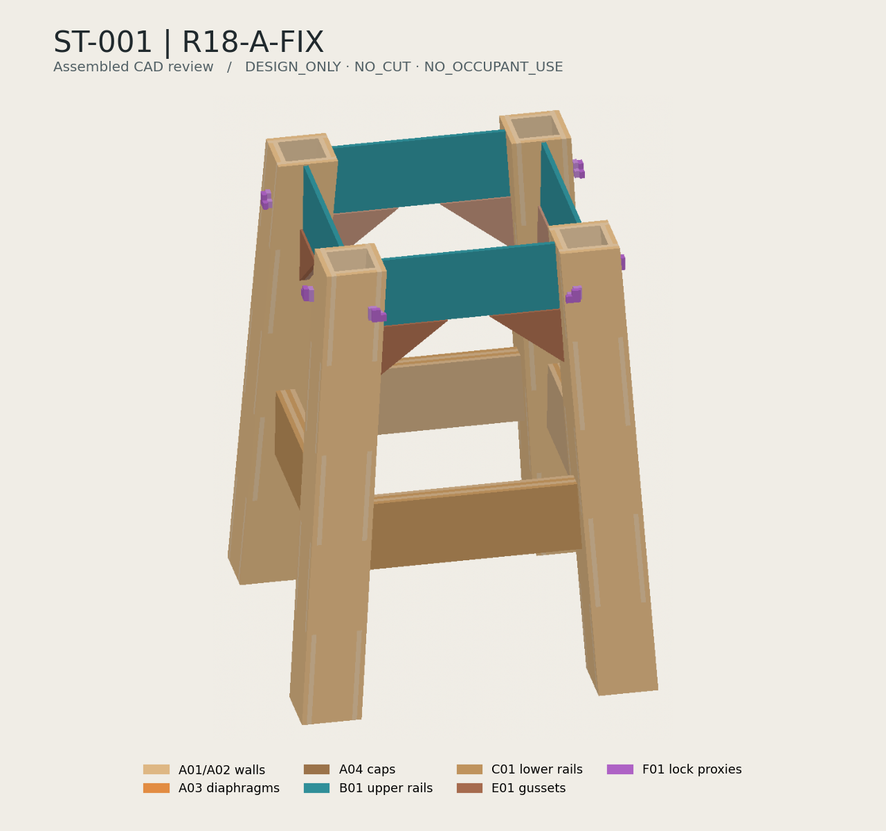

# ST-001 R18-A-FIX — מודל סקירה דיגיטלי

**PARTIAL · DESIGN_ONLY / NO_CUT / NO_OCCUPANT_USE**

Issue #126 · משימת אב #122 · דוח R18-A ב־#123 · מסירה לסקירת R18-B

[דוח מסירה למנהל הפרויקט](DELIVERY_HE.md) · [יומן שינויים](CHANGES_HE.md) · [דוח QA](QA_HE.md) · [מפת ממשקים](evidence/INTERFACE_MAP.png)



## פתיחת המודל ושחזור

- אפשר לפתוח את [מסמך FreeCAD](evidence/R18A_FIX_REVIEW.FCStd) ולבחור כל שכבה בעץ הרכיבים. קבוצת F01 מכילה שמונה סמלים דו־שכבתיים למיקומי נעילה פתוחים. במציג GLB היא מוצגת בסגול.
- [GLB מורכב](evidence/R18A_FIX_ASSEMBLED.glb) · [GLB מפורק](evidence/R18A_FIX_EXPLODED.glb) · [תצוגה מפורקת](evidence/R18A_FIX_EXPLODED.png).
- המקור הפרמטרי הוא [parameters.json](parameters.json) ו־[model.py](model.py). לשינוי פרמטר, עורכים את JSON ומייצרים מחדש. ה־FCStd הוא תצלום מצב של המוצקים שנוצרו באותה הרצה. [review.py](review.py) מפיק את תוצרי הסקירה ומריץ את הבדיקות.

נבדק עם FreeCAD 1.0.0, Python 3.13, NumPy, SciPy ו־Matplotlib. בהרצת Debian עם מודולי FreeCAD זמינים:

```sh
cd engineering-reviews/ST001/R18A_FIX
PYTHONPATH=/usr/lib/freecad-python3/lib /usr/bin/python3 review.py --output /tmp/st001-r18a-fix
```

אפשר להוסיף `--baseline-archive /path/to/ST001_R18A_DIGITAL_REVIEW.zip` לאימות ה־SHA-256 וקריאת טבלת הליקויים המקורית מה־ZIP. ללא הארגומנט נעשה שימוש ב־[רשומת הבסיס שנקראה מהארכיון](evidence/BASELINE.json). נמדדו המודלים המצורפים של R18-A. בנייה מחדש של סקריפט ההדמיה הישן הייתה מצריכה את R16, והמקור החדש נבנה מהפרמטרים המתועדים.

## מערכת צירים ופרמטרים

- CAD במ״מ, ימני, Z אנכי ומישור הרצפה Z=0. צירי U/V של חזיתות הגוף מסובבים 45° סביב Z ביחס ל־X/Y. רגל 1 נמצאת בצד Y השלילי, רגליים 2–4 ברבעי הסיבוב הבאים, וצד i מחבר את רגל i לרגל הבאה. GLB במטרים, בצירים `(X, Z, -Y)`. בפירוק משתנות הזזות בלבד.
- דרישות סקירה מנחות מ־#126 הן ארבע רגליים, גובה 400 מ״מ, חתך אופקי חיצוני 50×50 מ״מ, עובי נומינלי 4 מ״מ לשכבה, מכסים במישור משותף ו־60 רכיבים / 104 שכבות במפרט. הגוף כולל קושרות צדיות ומשולשי חיזוק בלי איקס, פלטה או מושב. בירץ׳ 4 מ״מ הוא ייחוס חומר, ו־900×450 מ״מ (גובה×רוחב) הוא ייחוס לתקציב חומר.
- זווית הנטייה, היסטי המרכז וגובהי הקורות נגזרו ממדידת GLB מורכב של R18-A ועוגלו לערכים שבפרמטרים. החתך נמדד אופקית ב־U/V, בשלושה גבהים בכל רגל. דפנות הוזזו לפי הנטייה ועובי 4 מ״מ נמדד בניצב לפאה. החתך הניצב לציר הרגל הנטויה הוא מקבילית קלה בגרסה זו. ההגדרה המקצועית של מישור מדידת החתך פתוחה לאישור R18-B.
- A01/A02 מפוצלים לצמדי פאות U/V לצורך מזהי סקירה. גובהי מרכזי המחיצות הם 125, 200 ו־275 מ״מ. ארבע מחיצות האמצע הן מיקומים אינטרפולטיביים שטרם אומתו. מיקום המחיצות, פסי ההמחשה של האצבעות, פרטי הכיס והלשונית ומיקומי F01 הם פרמטרים זמניים.
- FJ-EDGE מיוצג בפינות מתחלפות. FJ-TAB-SLOT מיוצג בלשונית ובכיס בשכבה פנימית אחת בכל מחיצה. FJ-NODE מיוצג בקצות קורות שהותאמו לשיפוע הדופן, ובמשולשים שנוגעים בדופן וברפרפה. F01 מסומן בסמלים מחוץ לגוף, בקשר לצמתים העליונים. [טבלת ממשקים](evidence/INTERFACES.csv)
