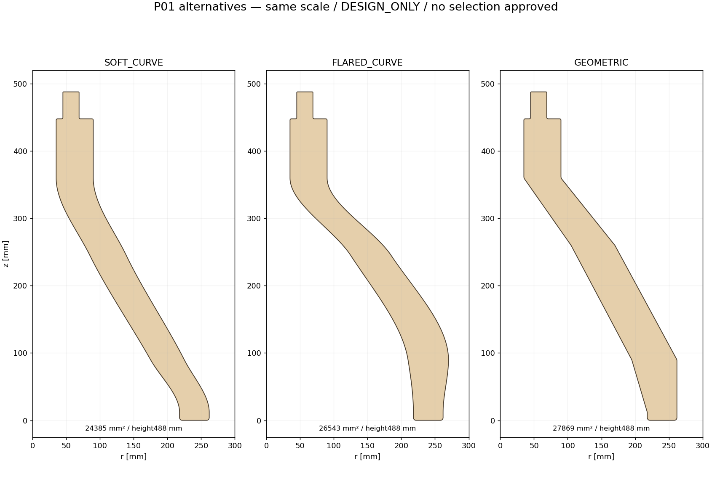

# CTB-001 — P01 design alternatives / DESIGN_ONLY

**AWAITING_DESIGN_SELECTION**. No variant approved, no G1 release, no CTB-002 start.
Issue #3 authorizes concepts on `codex/ctb-001-leg-cheek`, based on main
`e65e59025ca5fe423b83585c62d9353ec1ee434f` (CTB-000 PR #2 merged).

| Candidate | Planar material area, one face | Single-part padded envelope W×H (10 mm each edge) | Character / practical trade-off |
|---|---:|---:|---|
| SOFT_CURVE | 24,385.48 mm² | 247×508 mm | Gentle continuous sweep, least planar material, less pronounced lower flare. Smooth monotone cubic rails; curve-cutting and grain/weak-axis behavior still need process/material review. |
| FLARED_CURVE | 26,543.39 mm² | 255×508 mm | Fuller lower silhouette, visibly outward at z90 (outer r270 vs225 in soft); same floor landing. More material and envelope width; flare does not increase the nominal foot support polygon or prove strength. |
| GEOMETRIC | 27,869.48 mm² | 247×508 mm | Faceted architecture with R6 eased transitions, straight runs simplify dimensional inspection. Greatest planar area; potentially more concentrated section/curvature transitions. No structural preference is established. |

**Proposed candidate for review: SOFT_CURVE**, because it uses the least planar material
and offers a continuous, restrained sweep while preserving exactly the same attachment,
contact geometry and sheet allowance. This is a recommendation, not an owner selection,
strength ranking or completed engineering-lead decision. FLARED_CURVE is the aesthetic
alternative if a fuller lower silhouette is preferred; GEOMETRIC if architectural facets
are preferred. The three profiles are different by >1000 mm² pairwise symmetric difference.

## Common concept, dimensions and construction

BOM is **P01×6 nominal6 mm birch**. One chosen profile is duplicated without scaling
or mirroring into three radial legs at0°/120°/240°, t=±10.5 mm. The 15 mm gap and27 mm
outside section are nominal, dependent on measured stock thickness. Four future spacer
bands remain uncut. No spacer, Y, disc, ring or lock component is designed here.

All cheek heights are488 mm; tabletop underside remains450, overall table500 and
outer diameter350. Upper material envelope is r35..90 until the shoulder easing;
shoulder plane448, with R2 easing ending at450. Tongue spans r45..69 from z450 to487;
R1 nose easing leaves22 mm flat at488. It passes both candidate disc Z intervals
456..462 and480..486 with full24 mm section, has2 mm beyond the upper disc,6 mm below
top skin494. These are section/envelope results only: neither disc slots nor insertion,
positive retention or adhesive load transfer is proven. Conservative tongue corner
radius within the Ø190 disc envelope is70.30825 mm, leaving24.69175 mm to its edge;
that is not slot clearance or verified joint engagement.

Foot outline is r218..262. Eased ends leave a flat landing r222..258 at floor z0,
center240 and width36 mm; nominal extruded contact strip is36×6 mm per cheek. Actual
floor contact may differ with warping, finishing and compliance. Projection of the
six nominal strips gives a support convex hull with minimum origin-to-edge distance
140.69134 mm, versus120 mm for the three contact-center triangle. Both remain inside
the top's175 mm radius in some directions; tipping load cases, total center of mass,
friction, stiffness and material strengths are unknown. No load rating or stability PASS.

Profiles have continuous single contours, no holes/islands. Minimum sampled horizontal
body section is36 mm. Radius6 geometric erosion stays a single connected polygon;
these are explicit geometry screens, not minimum safe structural sections. Smooth rails
are piecewise cubic Hermite with continuous tangent and bounded chord approximation;
curvature can change at rail stations and is not certified as a CNC toolpath. Circular
easings are R1 tip, R2 shoulders/root, R4 foot, and R6 body facets for GEOMETRIC.
Ideal planar radii≥1 mm are screened, not certified machinability or safe edge finish.

10 mm per-edge allowance is an explicitly provisional study value. Per-part fit on
portrait800(H)×440(W) is proven geometrically; orientation/grain, nesting, kerf, margins,
fixturing and final process review remain open. DXF/SVG profiles are1:1 mm; raster1:1
only at96 dpi and100% print; dimensioned/isometric layouts are review sheets.

## Reservations and open decisions

See [interface matrix](CTB-001-INTERFACE-MATRIX.md) and machine-readable
[results](CTB-001-interface-results.json). No baseline interface or B01–B13 status changes.

- B03: three candidates now exist, but final geometry awaits selection, independent review,
  engineering-lead G1 decision and downstream interface agreement. It is not closed.
- B04: Y arm ends94, upper cheek envelope90. Remedy A extends P01 envelope to at least98
  near410; remedy B shortens/reworks Y to86 or less. Each reserves an illustrative4 mm
  end land, not a certified structural minimum. Neither is adopted. CTB-003 must coordinate.
- B05: ring study band225..265 overlaps spacer reservation237..253. Keep material uncut;
  CTB-002/006 must agree heights and engagement. No ring-dependent design is finalized.
- B07/B11: floor contacts and projection only. Material grain, load cases, adhesives and
  tipping/strength/physical floor testing pending.
- B10: slot sizes, actual stock thickness, gap and kerf await coupons. See P01 fit worksheet.
- B01/B02: lock/access study around z486..494 and assembly sequence unresolved. A bare
  cheek preview cannot prove Y/disc/lock assembly or absence of integrated interference.
- B06/B08/B09/B12/B13 remain as recorded: hub/rib joints, rim bending/joints, exclusion of
  legacy CAD and center opening are outside P01 and are not closed by this work.

Independent automated QA is documented separately. It is not engineering-lead approval.
No merging, manufacture, CTB-002 progression or approved alternative is implied.
