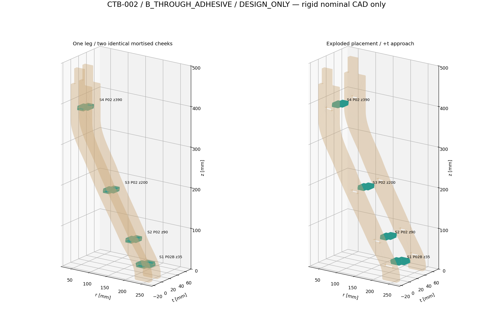
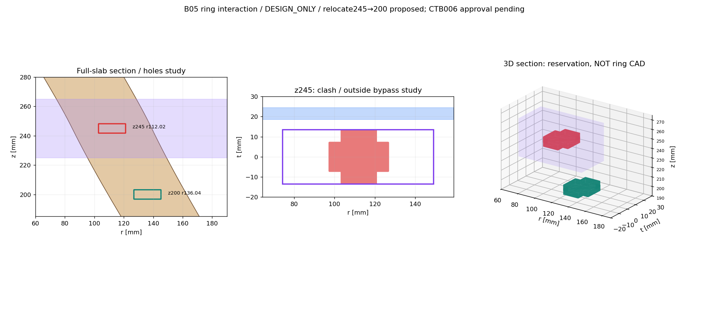

# CTB-002 — P02/P02B joint study / DESIGN_ONLY

**DESIGN_REVIEW_PENDING**. Working recommendation B_THROUGH_ADHESIVE only; no final
G1 joinery/physical manufacture approval. Uses SOFT_CURVE selected in P01-SEL-001,
from unchanged main849d40c45ddad721dc2aafec8241b45d9cf56a62 after PR#4.

## Three connection options and decision

| Concept | Geometry and capture | Minimum candidate cheek land | Checks / disposition |
|---|---|---:|---|
| A_KEYED_HEAD | Single-piece plate with wider wooden end heads and necks; elongated entry/seat aperture,6 mm radial locking slide; removable by reverse slide |1.71687 mm at lower spacer| Static nominal placement has0 collision, but fails6 mm land hypothesis. Coordinated slide sequence/reverse-slide keeper unresolved; BLOCKED / not selected. Heads reach t±17.5, extending to35 mm beyond the27 mm cheek envelope. |
| B_THROUGH_ADHESIVE | Stepped horizontal plate, centered through-tabs, internal shoulders; candidate adhesive/captured-cheek sequence |8.00037 mm| Final15 pairwise intersections0; continuous insertion15 sweep intersections0. Selected CAD WORKING PROPOSAL for review. Shoulders bear inward only; no positive outward retention before an unvalidated adhesive/capture procedure. |
| C_ASYMMETRIC | One tab offset−8/+8 for P02,−8.5/+8.5 for P02B; positive end engages4 mm, negative6; identical cheeks contain BOTH offset holes |6.66143 mm after repair| Nominal static and continuous local sweeps pass.8 holes/cheek vs4 for B, one unoccupied at each station/side; reduced engagement, more kerf-sensitive and weaker residual lands; feasible CAD alternative, not preferred. No claimed puzzle lock. |

Each spacer is one connected laser-candidate plywood piece with no purchased hardware.
A's head concept is mechanically plausible as unilateral sliding capture, but cannot be
advanced in this fixed master without land/envelope/keeper redesign. No extra loose key
is hidden in the BOM. Its proposed removal principle is a study, not a proven retention
mechanism. Do not implement A from its BLOCKED cut-candidate files.

B is preferred because it needs just four simple closed mortises per cheek, broad tabs,
more residual land than either alternative, and a demonstrated rigid local assembly path.
It is not a strength ranking or permission to cut/glue. C keeps interchangeability by
adding unused mirrored-offset holes, not by quietly making different left/right cheeks.
For C, ordinary between-hole web7.6 mm; lower web6.6 mm after repair. No rotational or
asymmetric mechanical capture is asserted beyond its actual shoulder/slot geometry.

Cut counts per B leg: four spacer outer contours (3 identical P02 +1 P02B), plus each
of two cheeks with one unchanged exterior and four candidate mortises. A also uses four
openings per cheek but much larger apertures/heads. C uses eight per cheek. Alternative
counts are not additive quantities. All contours are ideal, uncompensated DESIGN_ONLY.

## Two spacer geometries and exact stations

Nominal6 mm birch plywood plates in local(r,t), thickness along z. P01 is(r,z), thickness
along t. B dimensions: P02 body30 mm radial×15 mm bridge; centered radial tabs18 mm,
reaching6 mm into each cheek (overall t27). P02B body40 mm and tabs24, same thickness
and span. Wider landing/material/tab engagement is geometric reinforcement only, no load
rating. Proposed primary face grain along t; actual plywood layup/defects and adhesive
properties need specification and physical testing.

| Station | Part | CenterZ | Center r | Common r interval over full6.4 mm slot slab |
|---|---|---:|---:|---|
| S1 | P02B |35|234.22063|213.20381..255.23745|
| S2 | P02 |90|200.11942|176.87827..223.36057|
| S3 | P02 |200|136.03855|111.17193..160.90518|
| S4 | P02 |390|62.50000|35.00000..90.00000|

Stations derive from the parametric SOFT_CURVE polygon at both slab ends and every
contour vertex between them. The three P02 source geometries are identical; only r/z
placement differs. Standard slot18.4×6.4; lower24.4×6.4. Per-side0.2 mm radial/z allowance
is a CAD assumption, not calibrated fit. Slots idealR0.2; spacer convexR0.5/rootR0.1.
These small ideal radii are laser candidates needing process/kerf/edge review, not a
machining capability or safe edge claim. Physical edge thickness is unrounded in this
model. Residual6 mm is a land hypothesis, not a proven structural minimum.

B envelope per part with10 mm each-edge allowance: P02 W50×H47; P02B W60×H47 in local
(r,t) cutting plane. Cheek candidate remains W247×H508. All fit portrait H800×W440,
but this is single-part bounding fit, not nesting, grain approval or production margins.

## B05 ring conflict: two complete local options

1. **Recommend relocating the provisional spacer245→200 (PC-CTB002-01).** Keep all four
   spacers, including P02B35. Ring study band225..265 has22 mm Z separation from plate
   top203,21.8 from mortise top203.2. Zero spacer overlap with the conservative ring
   reservation box. No new hole lies in225..265. CTB006 must approve the height/interface
   and actual ring attachment; no ring joint is designed or IF09 closed here.
2. **Retain245 and coordinate outside bypass.** A local study route at t18.5..24.5
   leaves5 mm from nominal outer cheek t13.5 and no overlap with the spacer. It requires
   an outward ring offset/return connection and unknown restraint/strength/whole-ring
   route. No such connection is finalized or cut. This remains conditional/BLOCKED for
   integration until CTB006 resolves the actual geometry. The fourth spacer is retained.

The original245 plate lies wholly in the225..265 conservative reservation and overlaps
it by3993.37749 mm³; this is a reservation conflict, not evidence of an actual unknown
ring solid colliding. Reference/new section intervals and all four-station overlap
matrices are in assembly/ring-interference-study.json. At245 the full6.4 mm slot slab
common radial section is86.59868..137.43661; at200 it is111.17193..160.90518. No locked
baseline parameter changes; original provisional245 remains in CTB000 and P01 history.

## Local assembly evidence and gaps

See assembly/INSERTION-ORDER.md and collision-and-insertion.json. Fixture one cheek,
insert all four spacers along−t, then bring the second identical cheek along−t. Full
continuous Minkowski/extruded material sweeps, not just positions/animation, show no
material collision in the nominal B path. Shoulder contacts have positive bearing area;
slot radial/z gaps are intentional0.2 mm hypotheses. Adjacent spacers are separated.
Independent OpenCASCADE reconstruction uses exported SVG paths and different sweep logic.

Nominal6 mm produces gap15 / outside27. Hypothetical5.6 mm stock produces gap15.4 and
unintended0.2 mm shoulder gaps each side;6.4/6.8 produce actual model interference
(maximum pairwise19.39383/103.15629 mm³). None is a physical measurement. Use measured
stock/kerf coupons before redesigning fit; do not present6.0 as measured. Glue squeeze-out,
access, fixturing, clamp loads/cure and friction are not simulated. B lacks positive
outward retention without a later reviewed adhesive/capture strategy.

Upper mortise top393.2 leaves13.7 mm to the existing Y mortise reservation406.9 and
56.8 mm to tongue start450. This is Z-envelope separation only; Y r94/r90 remains B04.
Foot exterior/landing and upper tongues are untouched. B01/B02 whole-table retention/
assembly, B03 final coordinated part approval, B05 ring attachment, B07 stability,
B10 fit and B11 material/load all remain open. B06/B08/B09/B12/B13 are also preserved.
No final Y/discs/ring, full tripod, structural capacity or physical readiness is claimed.
