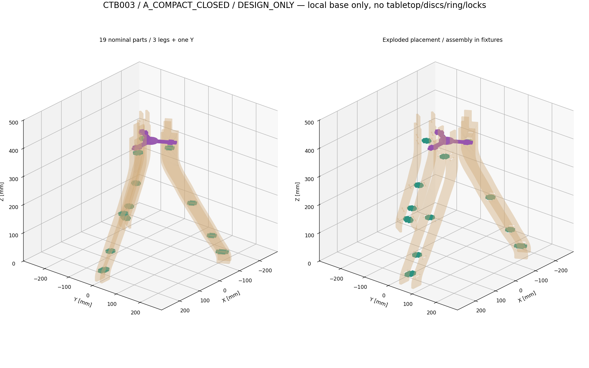
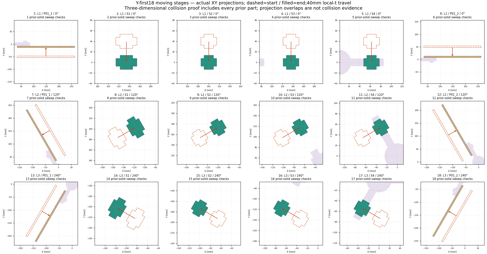

# CTB-003 — CSH-3Y / P03 joint comparison

**DESIGN_ONLY / DESIGN_REVIEW_PENDING**. Proposed working candidate **A_COMPACT_CLOSED**,
not a lead-approved selection, cutting release, final G1 lock or complete product assembly.
Base: ecee5f0633a6d7c122087ba75c92eddad4cb0932. SOFT_CURVE/P01-SEL-001 and selected
B_THROUGH_ADHESIVE/CTB002-SEL-001 remain byte-preserved active references. Historical
CSH3Y ZIP is a provenance pointer only; no real verified file was supplied/imported.

## Three genuine joint concepts

| Concept | P03 and cheek interface | Land / engagement hypothesis | Assembly result / trade-off |
|---|---|---|---|
| A_COMPACT_CLOSED | Local armtip85.5; side tabs58..74; one closed hole per cheek |4.5 end margin to r90; Y-hole15.8 mm to cheek edge;16 mm nominal radial tab bearing span/side| Recommend: unchanged exterior, one simple extra hole, largest closed-hole land. Y-first PASS; all3 tested prebuilt routes BLOCKED. No positive outward-cheek retention. |
| B_DUAL_CLOSED | Same tip85.5, two tab pairs52..62 and72..82 |20 mm total radial span/side (+25% geometric span, not strength); lands16.8/7.8;9.6 web between holes| Y-first PASS; tested prebuilt routes BLOCKED. Distributed bearing hypothesis, more cuts and less outer land; no proof of increased strength/locking. |
| C_OPEN_REMOVABLE | Distinct shorter tip82, tabs54..70; inner-edge-open cheek channel to70.2 |8 mm local end margin; outer bridge19.8, deliberate open-mouth land0| Prebuilt radial PASS; vertical/tangential BLOCKED. Changes exterior in candidate only (CTB003-CR-002), permits radial withdrawal and needs separately authorized retainer if one is required. Not selected. |

A is preferred for its closed-side-hole bearing concept, retained master exterior,
simpler cuts and fully demonstrated local Y-first sequence. This is a coordinated CAD
recommendation, not a statement that wood glue or the tab is a completed mechanical lock.
A/B restrain r/z motion after nominal allowances but do NOT positively retain outward
cheek separation. B spacers still rely on unvalidated adhesive/capture. C trades that
closed radial geometry for removable entry; no hidden key or fastener is added.

Each P03 is one connected6 mm birch candidate with three identical arms0/120/240 and no
islands. Hub nominalR24 (plan area1808.98323 mm²); core14.6 in15 gap gives0.2 mm per side,
neck section87.6 mm² before any stress analysis. Ideal rootR0.1/convexR0.5, hub polygon144
segments and arc chord≤0.005 mm are manufacturing hypotheses. Notch stresses, finite
beam/edge finish and machine capability unverified. Outer veneer grain cannot align with
all3 arms; plywood anisotropy, actual layup and material testing remain B11 prerequisites.

## B04 correction, coordinate meanings and lands

Old94 tip exceeded cheek local r90 by4 mm. Working A has **localr85.5**, so4.5 mm end
margin, while measured maximum **globalXYradius85.769983** is independently≤86. A
rectangular tip at local86 would reach global86.309; those coordinate notions are not
interchanged. B shares A's radial envelope; C is smaller (see exact dimensions JSON).
No approved exterior or frozen parameter changes. CTB000 keeps historical provisional94;
P03 records a versioned shortening proposal CTB003-PC-001, pending lead acceptance.

Alternative extending P01 to at least98 near410 to accommodate old94 is documented as
CTB003-CR-001, not implemented. It adds material/changes the selected outline and downstream
fit; shortening avoids that change. The illustrative4 mm land is not a structural minimum.
C notch change is separately CTB003-CR-002, candidate only with no upstream overwrite.

All Y planes Z407..413 (center410), candidate slots406.8..413.2,0.2 mm each radial/Z side.
Full nominal cheek thickness6 is engaged to t±13.5. A hole r57.8..74.2; B51.8..62.2 and
71.8..82.2; C open fromr34 (outside inner edge35) tor70.2. Both cheek faces have the SAME
pattern and rotate as one shared master. Candidate slots6.4 replace only the P03 study
reservation; original source6.2 (406.9..413.1) is not silently redefined.

Actual minimum slot distance to S4's unchanged B hole is13.6 mm (A, B's nearer hole, C),
not13.7 from the older source6.2 reservation. Y solid to upper spacer plateZ393 gap14;
Y top413 to underside450 gap37, to lower disc456 gap43, upper disc480 gap67. Ring band
225..265 is142 below Y bottom407. These are local separation/envelope results; no actual
ring/disc/top-lock is designed or proven. B05/IF09, B01 and full-system B02 remain OPEN.

## Continuous assembly analysis

A/B/C final19-body placements each have171 pairwise intersections below1e-6 mm³. That
alone does not establish an assembly path. The Y-first strategy completes one leg at a
time: first cheek approaches+t, four selected B spacers along−t, second identical cheek
along−t; repeat120/240. All18 moving sweeps include EVERY installed prior part:171 checks
per concept. All three pass this nominal local rigid-geometry route. External fixtures
hold Y/cheeks/spacers; clamp shape/access, friction, forces, cure and handling aren't
modeled or physically validated. Final contact/collision does not rate structure.

Prebuilt6-body modules (rigid group maintained by hypothetical external support, not
assumed proven glue) are each tried at radial60/tangential40/vertical80 mm offsets.
Every full path checks all6 moving bodies againstY and every prior completed leg (126
checks/route). Closed A/B holes block all3 approaches. C radial route passes; its other
approaches block. When an early stage blocks, later checks are counterfactual witnesses.

| Prebuilt route maximum material intersection, mm³ | Radial | Tangential | Vertical |
|---|---:|---:|---:|
| A |575.32939|2986.48937|3636.89729|
| B |718.65874|2601.04937|3275.18239|
| C |0 within epsilon|1033.00937|3816.86729|

The connector itself is also tried into all3 prebuilt modules simultaneously: lowered80
mm vertically and translated60 mm globally inX, each tested against18 fixed bodies.
All concepts block in these specified approaches. These are geometric obstructions of
the stated translations, not a universal proof against every possible rigid motion.
Use Y-first for working A; do not claim prebuilt leg insertion through closed holes.

Sweeps use exact segment/polygon Minkowski sums of the flattened contour, not sparse
poses. Independent OpenCASCADE reconstruction of actual SVG loops uses a different
boundary-edge sweep construction. Counts, all pair volumes and witnesses are in JSON.
Tiny2e-14 mm³ Manifold roundoff is below1e-6 threshold, not a physical tolerance.

## Fit, BOM and required reviews

BOM19: P03×1, identical candidate P01×6, unchanged P02×9 +P02B×3. No screws, loose keys,
ring, discs or extra hidden lock components. All per-part padded envelopes fit portrait
H800×W440 with provisional10 mm margins. This is not production nesting or stock/grain
approval. Actual thickness/kerf remain null;6.0 is not a measurement. Coupons, adhesive,
load paths, material properties and physical fit are pending. GLB uses metres; source,
SVG/DXF and data use mm. PNG1:1 only at96dpi/100%, review layouts are scaled sheets.

Lead must accept the P03 shortening/new-hole concept and Y-first sequence, coordinate
P01/IF02 and future ring/discs/top locks, and settle outward retention. B01/B02/B03/B04/
B05/B07/B10/B11 and other official records remain unchanged pending decision. B04 has
quantitative nominal CAD resolution evidence; it is not automatically closed by this PR.
No G2/G3/G4 or physical cutting/strength/stability approval is implied.
